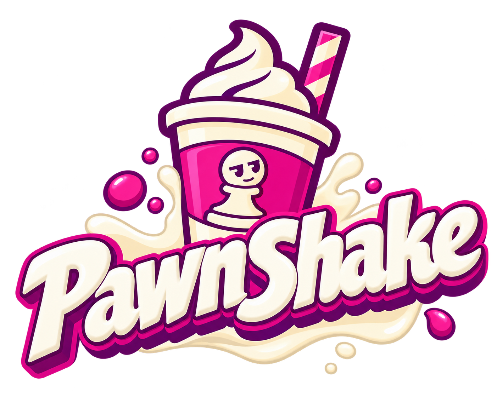

<p align="center">
  
</p>

# Pawnshake

**The Pawnshake protocol**: signed, peer-to-peer chess games with a clock.

Two players sign every move and every command (resign, draw, takeback, flag)
and send them straight to each other. A move is one byte (its index among the
legal moves), a whole record about 70 bytes. A server is optional:

| Game | Arbiter | Who keeps the time |
|---|---|---|
| offline | none | both devices, from signed timestamps they cross-check live |
| hybrid | checkpoints | the devices, plus server checkpoints that show who is still there |
| online | full | the server, from anchors (signed receipts over the game's head) |

Either player can upload a game later; anyone can verify it from the
signatures alone. Everything that is policy rather than protocol (allowances,
pause budget, how long a player may be gone, what leaving costs) is a
**rules profile** signed into each game, so every app can tune it.

Status: **draft**. The specification is still moving. Go and JavaScript
implement certificates, rules profiles, the genesis handshake, records (header,
body, wire format), chains with fork detection, anchor heads and receipts, the
canonical order, the lag quota and move codes; both are pinned to the same
vectors. Not implemented yet: the peer clock function and live checks.

## Layout

| Path | What |
|---|---|
| [`spec/PAWNSHAKE.md`](spec/PAWNSHAKE.md) | the protocol |
| [`spec/profiles/`](spec/profiles) | rules profiles, starting with [`whitepawn/1`](spec/profiles/whitepawn-1.md) |
| [`vectors/`](vectors) | conformance test vectors every implementation must pass |
| [`go/`](go) | Go implementation (`github.com/PawnTown/pawnshake/go`), 100 % test coverage |
| [`js/`](js) | JavaScript implementation (`pawnshake`), 100 % test coverage |
| [`viz/index.html`](viz/index.html) | interactive visualizer: step through scenarios, inspect every byte |

The visualizer is a single self-contained HTML file: open it in a browser. Its
clock function and canonical order follow the spec; signatures in it are demo
bytes. Notes and decisions written there are kept in the browser and exported
with "Copy notes".

## Go

```bash
cd go
go test -cover ./...
go test . -update && go test ./movecode -update   # regenerate the vectors
```

## JavaScript

```bash
cd js
npm install
npm run coverage
```

## Planned

- the peer clock function and live checks, in both languages
- `rust/` (crate `pawnshake`, the core for Flutter), `dart/` (pub `pawnshake`)
